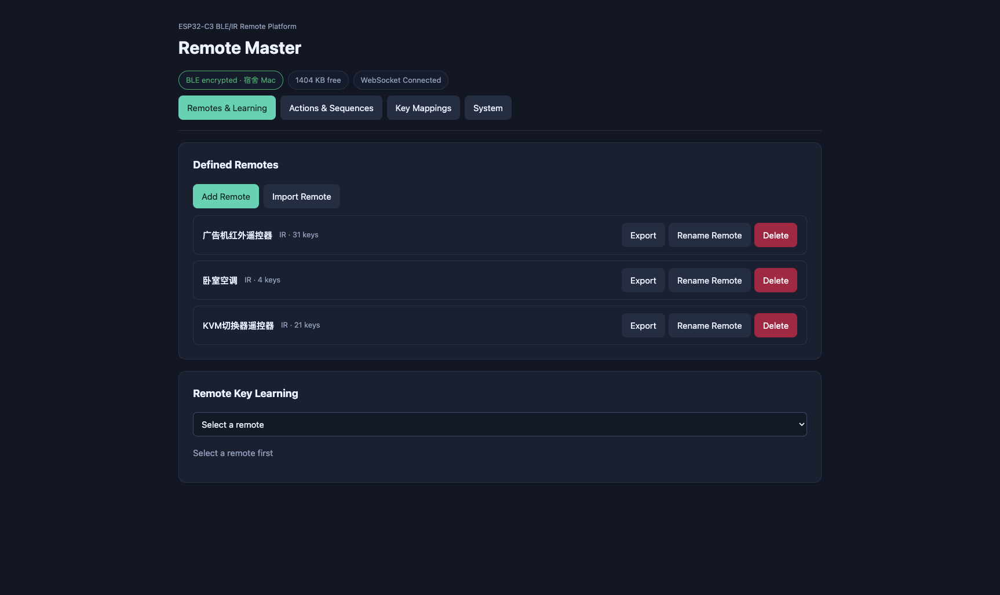
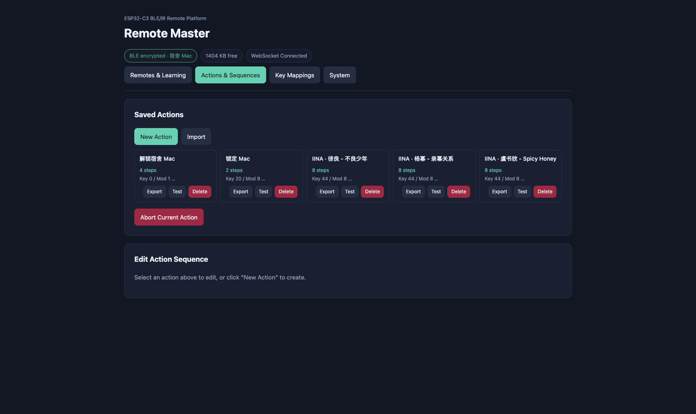
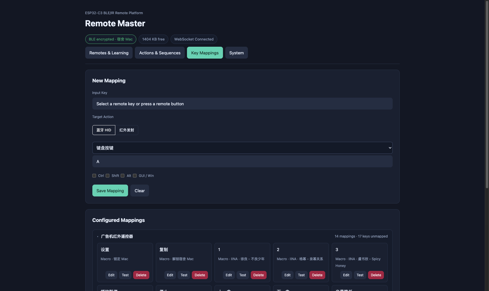
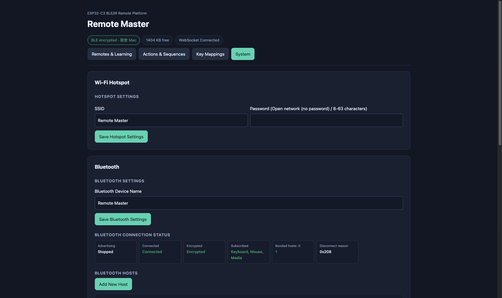

# Remote Master

**English** | [简体中文](README.zh-CN.md)

> ⚠️ **Just for fun.** This is a toy project. Over 90% of the code was generated by AI and has not been rigorously tested. Do **not** use it in production scenarios where reliability matters (e.g. thermostat automation, presentation clicker for important meetings, or any safety-critical application). Use at your own risk.

An ESP32-C3 infrared-to-BLE-HID bridge with a built-in web UI. Learn signals
from an ordinary IR remote, map its buttons to Bluetooth keyboard / mouse /
media actions or IR replay, and manage the whole configuration from a browser.

## Features

- **IR learning and replay** — captures raw pulse data from an IR receiver and
  stores it per key, with protocol/code identification and a selectable GPIO4
  transmitter drive mode.
- **BLE HID output** — acts as a Bluetooth Low Energy keyboard, mouse and media
  remote. Up to 3 hosts can be paired and switched from the web UI.
- **Flexible mappings** — bind a learned key to a HID key combo, mouse action,
  media key, IR replay, or a multi-step macro.
- **Macros** — compose HID and IR steps (press, release, text, delay, IR replay)
  with per-step timing.
- **Real-time feedback** — WebSocket pushes config changes, device status,
  learned input events and errors; pressing a physical remote button highlights
  the matching key card in the UI.
- **Self-contained deployment** — the Vue frontend is served directly from the
  device's LittleFS, so the browser needs no internet access.

## Screenshots

| Remotes & Learning | Actions & Sequences |
| --- | --- |
|  |  |

| Key Mappings | System |
| --- | --- |
|  |  |

## Hardware

| Item | Details |
| --- | --- |
| MCU / module | ESP32-C3 SuperMini (Arduino ESP32 core 3.x) |
| IR receiver data | GPIO5 |
| IR receiver power | GND GPIO6, VCC GPIO7 |
| IR transmitter | GPIO4 |
| Status LED | GPIO8 |
| Storage | LittleFS on internal flash |
| Network | Wi-Fi access point (default SSID `Remote Master`, `192.168.4.1`) |

The device runs as a standalone access point; no router is required. Set a
WPA2 password (8–63 characters) in **System → Wi-Fi** to secure it, or leave it
empty for an open AP.

## Repository Layout

| Path | Purpose |
| --- | --- |
| `remote-master.ino` | Firmware entry point, Wi-Fi/HTTP/WebSocket setup, learning flow |
| `remote_store.cpp/.h` | Configuration persistence and validation |
| `ble_hid.cpp/.h` | BLE HID device, pairing and host management |
| `ir_tx.cpp/.h` | RMT-based IR transmitter |
| `bindings.cpp/.h` | Action model and dispatch |
| `action_router.cpp/.h` | Routes mapped actions to BLE HID / IR output |
| `file_api.cpp/.h` | `/api/files` upload, listing and deletion |
| `fallback_ui.h` | Minimal fallback page when the frontend is missing |
| `web/` | Vue 3 + Vite frontend source |
| `data/frontend/` | Frontend build output (device filesystem image) |
| `deploy.mjs` | Mirrors `data/` to the device over HTTP |

## Getting Started

### Prerequisites

- Arduino IDE or `arduino-cli` with the ESP32 board package 3.x
- Libraries: **ArduinoJson 7.x**, **IRremote 4.x**, **NimBLE-Arduino 2.5.x**,
  **ESPAsyncWebServer** (with AsyncWebSocket)
- Node.js 18+ for the web UI

### Firmware

1. Open `remote-master.ino` in the Arduino IDE.
2. Select board **ESP32-C3 Dev Module**.
3. Select partition scheme **No OTA (2MB APP / 2MB SPIFFS)**.
4. Flash the firmware.

The default 1.2 MB application partition is too small. Back up configuration
and captures before changing the partition layout of an existing device.

```bash
arduino-cli compile --fqbn esp32:esp32:esp32c3:PartitionScheme=no_ota .
```

### Web UI (development)

```bash
cd web
npm install
npm run dev
```

The dev server listens on `http://localhost:5173` and proxies `/api/*` and
`/ws` to the device address in [`web/.env.development`](web/.env.development)
(default `http://192.168.4.1`). Connect your computer to the device's Wi-Fi
first. The same file is read by `deploy.mjs`, so the device address only needs
to be changed in one place.

### Build and deploy

```bash
cd web
npm run deploy
```

This builds the frontend into `data/frontend/` and uploads `data/**` to the
device. To deploy without rebuilding, or to target a different address:

```bash
node deploy.mjs http://192.168.4.1
node deploy.mjs --no-clean        # keep files already on the device
node deploy.mjs --dir ./data --remote /frontend
```

Alternatively, use the Arduino IDE's **Upload LittleFS data** action with the
`data/` folder — the result is identical.

## Using the Web UI

| Page | Purpose |
| --- | --- |
| **Remotes & learning** | Add, rename, export, delete remotes; enter learning mode and name captured keys; replay saved keys |
| **Actions & sequences** | Create macros and test them; export a single macro |
| **Key mappings** | Bind learned keys to BLE HID actions, IR replay or macros |
| **System** | Wi-Fi hotspot, BLE name/pairing/status, IR transmitter mode, storage, factory reset |

Typical workflow:

1. Add an IR remote, select it and start learning.
2. Point the physical remote at the receiver and press a button; name the
   captured key and save it.
3. Open **Key mappings**, choose the input key and an output target, then test.
4. Pair a computer under **System → Bluetooth hosts** and use the remote.

### IR transmission modes

Set the GPIO4 drive mode in **System → IR**:

| `irTxMode` | Output |
| --- | --- |
| `off` (default) | High impedance, no internal pull-up/down |
| `push-pull` | Active-high carrier, idle low |
| `sink` | Active-low open-drain carrier, idle released |

Use a current-limiting resistor and keep GPIO current within the ESP32-C3
ratings; use a transistor driver for higher LED currents. GPIO4 is not 5 V
tolerant — sink-mode circuits must not pull it above 3.3 V.

RMT generates a 33% duty carrier and replays one captured frame with
receiver mark-excess correction. A saved `carrierHz` takes precedence;
otherwise Sony uses 40 kHz, RC5/RC6 36 kHz, Panasonic/Kaseikyo 37 kHz,
Bang & Olufsen 455 kHz, and unknown protocols 38 kHz. The receiver records
only the envelope, not the carrier; automatic repeats, toggle-bit updates and
multi-frame reconstruction are not performed.

## Configuration and Storage

- Configuration lives in `/remote-config.json`; raw captures live in
  `/captures/`; the frontend lives in `/frontend/`.
- The configuration JSON shares a **32 KiB** budget. Limits: **12 remotes**,
  **3 BLE hosts**, **50 macros**. Keys and mappings have no fixed entry-count
  limit, but they consume the same JSON budget.
- Each macro is limited to 12 steps, 512 ASCII bytes of text and 60 seconds.
- Writes are atomic (temporary file + rename). On boot, an unreadable or
  incompatible filesystem/configuration triggers a format so the device always
  starts in a usable state.
- **Clear configuration and data** formats the entire filesystem, removing the
  management frontend, all Bluetooth pairings and every configuration item.
  This cannot be undone; re-deploy the frontend afterwards.

## Device API

The firmware exposes HTTP endpoints and a WebSocket at `/ws` on port 80.

| HTTP endpoint | Description |
| --- | --- |
| `GET /api/status` | Device, BLE and IR status |
| `GET /api/config/meta` | Settings, hosts and ID counters |
| `GET /api/config/remotes` | Remotes |
| `GET /api/config/keys` | Learned keys |
| `GET /api/config/macros` | Macros |
| `GET /api/config/mappings` | Key mappings |
| `GET /api/export?scope=…` | Export `remote`, `macro`, `macros` or full data as JSON |
| `GET/POST/DELETE /api/files` | List, upload or delete files on LittleFS |

WebSocket requests use `{id, op, args}` and replies echo `id` with `ok` and an
optional `error`. Main operations: `state.get`, `settings.save`,
`remotes.save`, `keys.save`, `keys.batchSave`, `keys.send`, `learn.start`,
`learn.stop`, `mappings.save`, `mappings.test`, `macros.save`, `macros.test`,
`hosts.save`, `hosts.pair`, `hosts.reconnect`, `hosts.delete`, `hid.stop` and
`system.reset`.

Server-pushed events: `state`, `input`, `capture.error`, `ir.error` and
`config.changed`.

## License

MIT
